# Workshops 3 et 4 : Sécurité des dépendances (SCA) et DAST avec OWASP ZAP

Projet **VulnerableShop** (Java 21 / Spring Boot / Maven), volontairement vulnérable.

| Workshop | Thème | Outils |
|---|---|---|
| 3 | Sécurité des dépendances et librairies (SCA) | Dependabot, OWASP Dependency-Check |
| 4 | Détection automatique des vulnérabilités web (DAST) | OWASP ZAP |

Les deux workshops sont regroupés dans **un seul pipeline Jenkins** (voir la section 5).


---

## 1. Installation rapide

### Prérequis

- Java 21, Maven 3.9+, Docker Desktop
- Jenkins dans un conteneur (plugins Pipeline et Git, outil Maven nommé `Maven3`) avec le client Docker installé
- Credential Jenkins de type *Secret text* : `nvd-api-key` (clé d'API NVD)
- Un compte GitHub avec Dependabot activé sur le dépôt

### Compilation

```bash
mvn -B clean verify
```

### Lancer le pipeline

1. Créer un job Pipeline dans Jenkins : *Pipeline script from SCM*, branche du membre, script path `Jenkinsfile`.
2. Cliquer sur **Build Now**.
3. Récupérer les rapports dans les artefacts : `zap-reports/zap-baseline.html` et `target/dependency-check-report.html`.

---

## 2. Organisation du groupe

Le groupe travaille sur le même projet. Chaque membre dispose de sa propre branche et de son propre pipeline Jenkins. La configuration Dependabot et les alertes se trouvent sur `main`, car GitHub n'analyse que la branche par défaut. Le README est commun.

| Membre | Branche |
|---|---|---|
| Zaid Rabah | `zaid` |
| saad alghem | saad |
| soufiane hajib |  | 

---

## 3. Workshop 3 : SCA (Dependabot et OWASP Dependency-Check)

### 3.1 Dependabot

Le fichier `.github/dependabot.yml` surveille l'écosystème Maven :

```yaml
version: 2
updates:
  - package-ecosystem: "maven"
    directory: "/"
    schedule:
      interval: "daily"
    open-pull-requests-limit: 10
    labels:
      - "dependencies"
```

Dans **Settings → Code security**, le graphe de dépendances, les alertes Dependabot et les mises à jour de sécurité sont activés.

Deux dépendances volontairement obsolètes ont été ajoutées au `pom.xml` :

| Dépendance | Version | Raison |
|---|---|---|
| `org.apache.logging.log4j:log4j-core` | 2.14.1 | Version affectée par Log4Shell et d'autres CVE |
| `commons-collections:commons-collections` | 3.2.1 | Version affectée par des failles de désérialisation |

**Pull requests de mise à jour** (fusionnées dans `main`) :

| PR | Mise à jour | Type |
|---|---|---|
| #1 | `org.webjars:bootstrap` 5.3.3 → 5.3.8 | Patch |
| #2 | `spring-boot-starter-parent` 3.5.6 → 4.1.1 | **Majeure** |

La PR #2 est un saut de version majeure : une telle mise à jour peut demander une migration du code et ne doit pas être fusionnée sans vérifier la compilation.

**Alertes de sécurité** : 9 alertes sur 2 bibliothèques.

| Bibliothèque | Version | Alertes | Sévérités |
|---|---|---|---|
| `log4j-core` | 2.14.1 | 7 | 2 critical, 1 high, 4 moderate |
| `commons-collections` | 3.2.1 | 2 | 1 critical, 1 high |

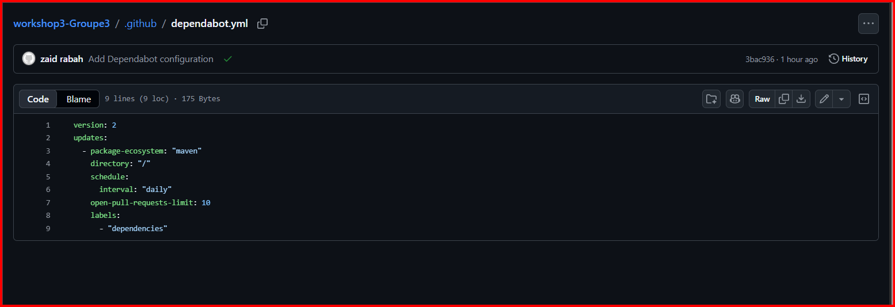
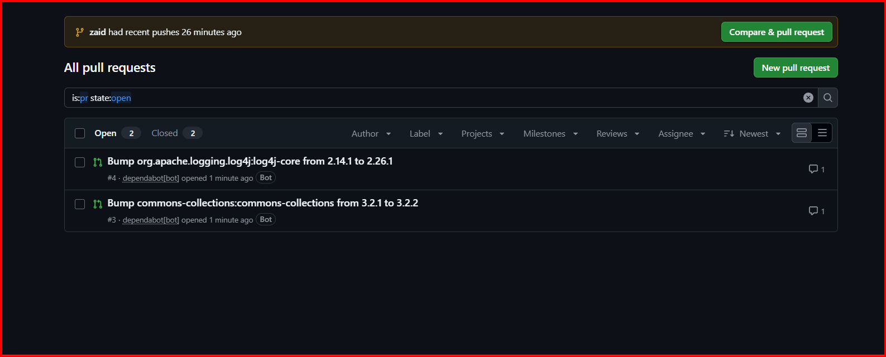
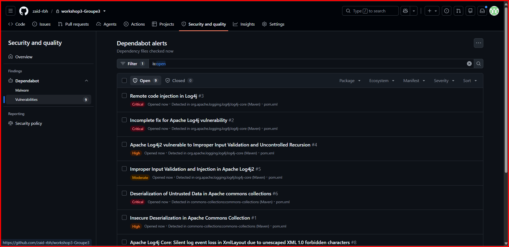

Les PR de mise à jour de version et les alertes de sécurité sont deux fonctionnalités distinctes : les PR peuvent exister sans alerte, et les alertes ne portent que sur les versions explicites du `pom.xml` de la branche par défaut.

### 3.2 OWASP Dependency-Check

Le scan est exécuté dans Jenkins avec une clé d'API NVD stockée dans un credential. Commande utilisée :

```bash
mvn -B org.owasp:dependency-check-maven:check \
  -DnvdApiKey=$NVD_API_KEY \
  -DdataDirectory=/var/jenkins_home/dependency-check-data \
  -Dformats=HTML,JSON \
  -DfailBuildOnCVSS=7 \
  -DautoUpdate=false \
  -DossindexAnalyzerEnabled=false
```

| Option | Rôle |
|---|---|
| `nvdApiKey` | Clé NVD lue depuis un credential Jenkins, jamais écrite dans le code |
| `dataDirectory` | Conserve la base NVD dans le volume Jenkins |
| `formats=HTML,JSON` | Rapport lisible et rapport exploitable par un outil |
| `failBuildOnCVSS=7` | Le build échoue à partir d'une CVE de score CVSS 7 (High ou Critical) |
| `autoUpdate=false` | Évite de retélécharger la base NVD à chaque build |
| `ossindexAnalyzerEnabled=false` | Désactive l'analyseur OSS Index, qui demande un compte |

Le premier téléchargement de la base NVD (environ 413 000 enregistrements) a duré plus de 8 heures, à cause de la limitation de débit de l'API NVD (nombreuses relances).

**Résultats avec le seuil CVSS 7 :**

| Dépendance | Version | CVE | Score CVSS |
|---|---|---|---|
| `commons-collections` | 3.2.1 | CVE-2015-6420 | 9.8 |
| `log4j-core` | 2.14.1 | CVE-2021-44228 | 10.0 |
| `log4j-core` | 2.14.1 | CVE-2021-45046 | 9.0 |
| `log4j-core` | 2.14.1 | CVE-2021-44832 | 6.6 |
| `log4j-core` | 2.14.1 | CVE-2021-45105 | Inférieur à 7 (non bloquant) |

Le build échoue comme prévu, car trois CVE dépassent le seuil de 7. Dependabot et Dependency-Check ont détecté les mêmes deux bibliothèques.

**Limite :** lors de ce scan, la mise à jour de la base NVD a échoué en cours de route et l'outil a utilisé les données locales. Les CVE trouvées sont anciennes et bien connues, donc les résultats sont fiables, mais le rapport peut ne pas contenir les vulnérabilités les plus récentes.

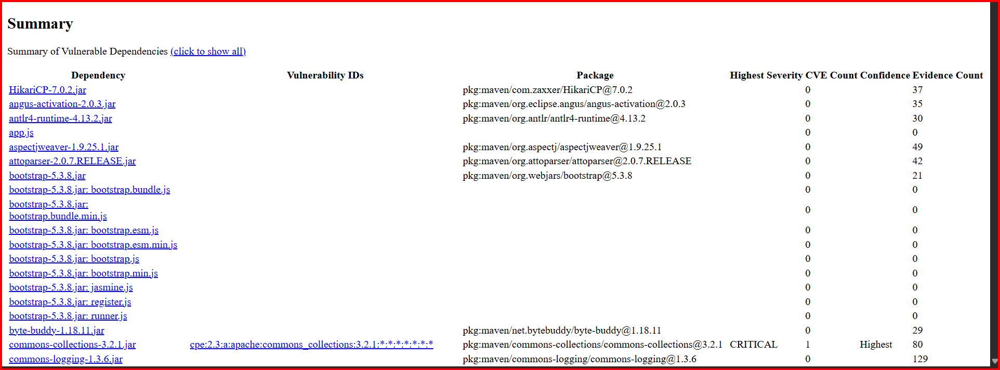
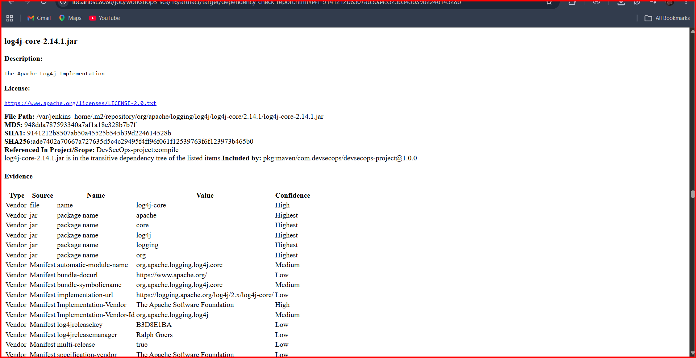
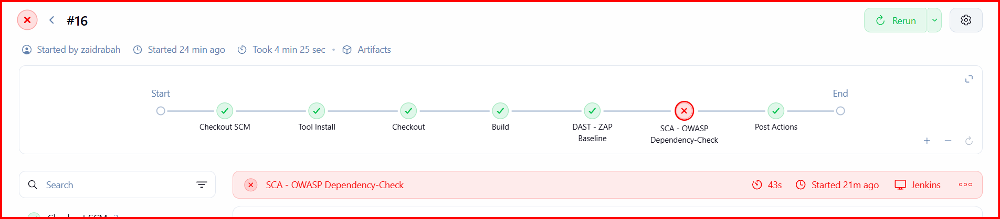
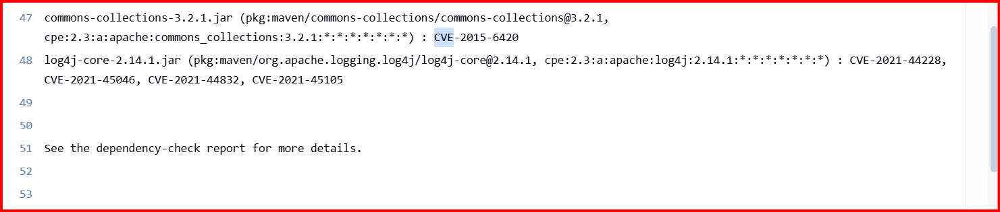

### 3.3 Corrections

Ce workshop a pour objectif de tester les outils et de détecter les vulnérabilités : **aucune correction n'a été appliquée au code**, et les versions vulnérables ont été conservées volontairement. Le pipeline reste donc en échec au stage Dependency-Check, ce qui montre que le seuil CVSS 7 bloque bien un build contenant des dépendances critiques.

Pour corriger ces vulnérabilités, il faudrait mettre à jour les deux dépendances dans le `pom.xml` vers les versions corrigées indiquées par les alertes Dependabot, puis vérifier la compilation avec `mvn -B clean verify` et relancer le scan.

| Dépendance | Version vulnérable | Correction recommandée |
|---|---|---|
| `commons-collections` | 3.2.1 | Version corrigée indiquée par Dependabot |
| `log4j-core` | 2.14.1 | Version corrigée indiquée par Dependabot |

**Bilan de l'état testé :**

| Indicateur | Valeur |
|---|---|
| Alertes Dependabot ouvertes | 9 |
| Dépendances vulnérables (Dependency-Check) | 2 |
| CVE de score supérieur ou égal à 7 | 3 |
| Pipeline | Échec du stage Dependency-Check (seuil CVSS 7) |

---

## 4. Workshop 4 : DAST (OWASP ZAP)

OWASP ZAP est exécuté en mode **baseline** (scan passif) via Docker contre l'application démarrée dans le pipeline. Le scan observe les réponses HTTP : cookies sans `HttpOnly` ou `Secure`, en-têtes de sécurité manquants, absence de jeton anti-CSRF. L'application cible est la version volontairement vulnérable du projet.

### 4.1 Intégration dans Jenkins : problèmes rencontrés

| Problème | Cause | Solution |
|---|---|---|
| `docker: not found` | Jenkins tourne dans un conteneur sans client Docker | Client Docker installé dans Jenkins, connecté au démon de l'hôte via `DOCKER_HOST=tcp://host.docker.internal:2375` |
| `network devsecops not found` | Le réseau utilisé n'existait plus ; Jenkins était attaché au réseau `zaid` | Utilisation de `--network zaid` |
| ZAP affiche son aide et ne scanne pas | Le dossier `/zap/wrk` n'existe pas dans l'image | Conteneur lancé en `root` avec `mkdir -p /zap/wrk` avant `zap-baseline.py` |
| `Connection refused` sur `jenkins:8081` | L'application n'écoutait pas sur toutes les interfaces, ou un ancien processus occupait le port | `--server.address=0.0.0.0` et `pkill` avant le démarrage |
| Verrou de la base Dependency-Check | Deux builds simultanés utilisaient la même base | `disableConcurrentBuilds()` |

Les rapports sont copiés hors du conteneur ZAP avec `docker cp`, car un volume monté depuis Jenkins ferait référence au système de fichiers de l'hôte et non à celui de Jenkins.

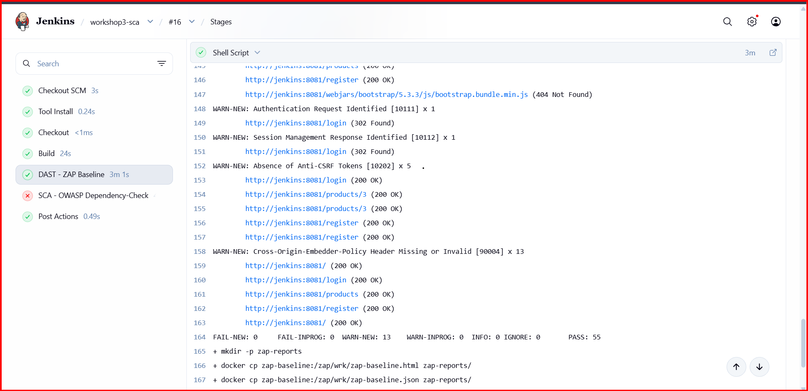

### 4.2 Résultats du scan baseline

Le rapport a été généré par ZAP 2.17.0 sur la cible `http://jenkins:8081` le 4 novembre 2026. Il contient 16 alertes :

| Niveau de risque | Nombre d'alertes |
|---|---|
| High | 0 |
| Medium | 3 |
| Low | 7 |
| Informational | 6 |
| Faux positifs | 0 |

**Alertes détaillées (cookies et en-têtes) :**

| Alerte | Risque | URL concernée | Correction recommandée |
|---|---|---|---|
| Cookie No HttpOnly Flag (cookie `JSESSIONID`) | Low | `/login` (POST) | Activer `HttpOnly` : `server.servlet.session.cookie.http-only=true` |
| Cookie without SameSite Attribute (cookie `JSESSIONID`) | Low | `/login` (POST) | Définir `SameSite` à `lax` ou `strict` : `server.servlet.session.cookie.same-site=lax` |
| Missing Anti-clickjacking Header | Medium | `/`, `/login` (3 instances) | Ajouter `X-Frame-Options` ou la directive CSP `frame-ancestors` |

Les 13 autres alertes du rapport (Medium, Low et Informational) ne sont pas détaillées ici.

**Analyse :**

- Le cookie de session `JSESSIONID` est envoyé sans `HttpOnly` : si un script malveillant s'exécute dans la page (XSS), il peut lire le cookie et détourner la session. L'absence de `SameSite` rend le cookie plus exposé aux attaques CSRF.
- L'absence d'en-tête anti-clickjacking permet d'intégrer les pages de l'application dans une iframe d'un site tiers.
- Aucune alerte High n'apparaît, mais cela ne signifie pas que l'application est sûre : le scan baseline est **passif**, il observe les réponses sans envoyer de charges d'attaque. Les failles du code, comme l'injection SQL détectée par Semgrep au Workshop 2, ne peuvent pas être trouvées par ce mode.

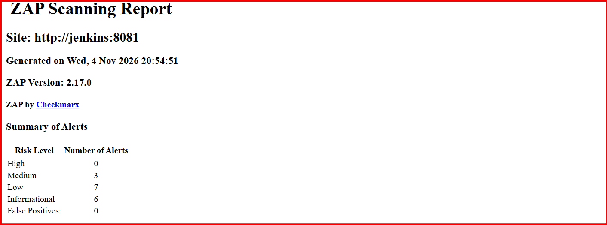
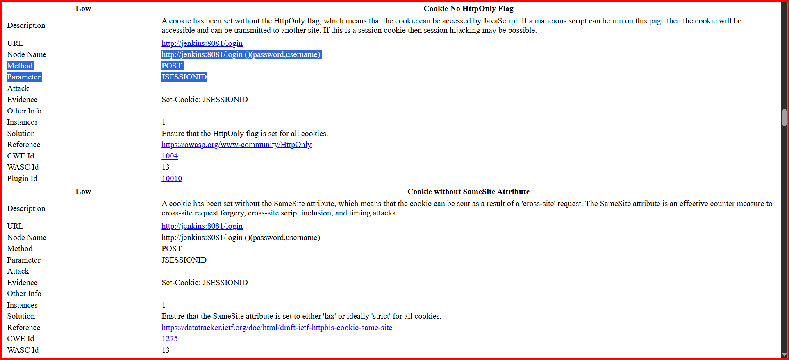
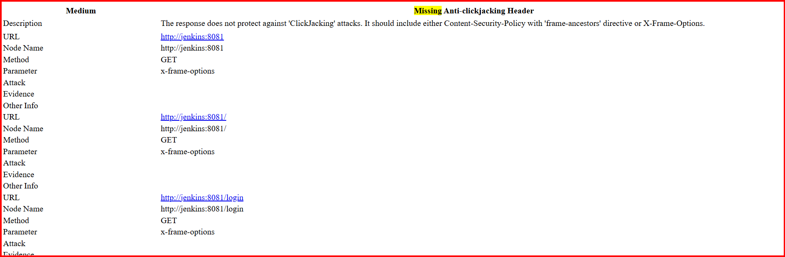

### 4.3 Scan actif

Le scan actif n'a **pas été exécuté** : l'énoncé le demande « si possible », et seul le scan baseline est intégré au pipeline. Les résultats de ce document viennent donc uniquement du scan passif.

Un scan actif envoie des charges d'attaque (XSS, injections) et peut détecter des failles que le mode passif ne voit pas, comme l'injection SQL. Il ne doit être lancé que sur sa propre application, jamais sur un système tiers ni sur un environnement de production. Pour le réaliser sur l'instance locale :

```bash
docker run --rm -v "$(pwd)/zap-reports:/zap/wrk:rw" -t ghcr.io/zaproxy/zaproxy:stable \
  zap-full-scan.py -t http://host.docker.internal:8081 \
  -r zap-full.html -J zap-full.json -m 5 -T 30 -I
```

---

## 5. Pipeline fusionné (Workshops 3 et 4)

Les deux workshops sont regroupés dans un seul `Jenkinsfile`. Dependabot n'en fait pas partie, car il s'exécute sur GitHub.

| # | Stage | Rôle | Workshop |
|---|---|---|---|
| 1 | Checkout | Récupère le code | |
| 2 | Build | `mvn -B clean verify` | |
| 3 | DAST - ZAP Baseline | Démarre l'application et la scanne avec ZAP | 4 |
| 4 | SCA - OWASP Dependency-Check | Cherche les CVE dans les dépendances, échoue à partir de CVSS 7 | 3 |

- Le stage ZAP est protégé par `catchError` : une défaillance de l'outil rend le build instable sans empêcher l'analyse des dépendances.
- Le stage Dependency-Check n'est volontairement pas protégé : un build rouge signale qu'une CVE de score supérieur ou égal à 7 est présente.
- `disableConcurrentBuilds()` évite les conflits de port et le verrou de la base Dependency-Check.
- Les rapports sont archivés dans les artefacts du build.

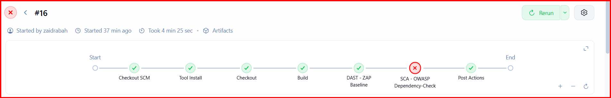
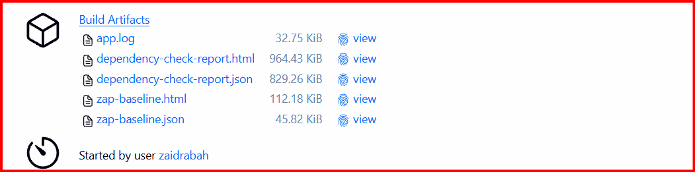

---

## 6. Comparaison des outils

| | Dependabot | OWASP Dependency-Check | OWASP ZAP |
|---|---|---|---|
| Type | SCA | SCA | DAST |
| Analyse | Dépendances du dépôt | Dépendances du build | Application en fonctionnement |
| Où il s'exécute | GitHub, en continu | Pipeline CI, à chaque build | Pipeline CI, application démarrée |
| Résultat | Alertes et PR automatiques | Rapport HTML/JSON, peut faire échouer le build | Rapport HTML/JSON des alertes web |
| Points forts | Propose le correctif lui-même | Seuil configurable | Voit la configuration réelle (cookies, en-têtes) |
| Limites | GitHub seulement, branche par défaut | Premier scan très long, faux positifs possibles | Scan passif limité, ne s'authentifie pas |

SCA et DAST sont complémentaires : l'un cherche des composants vulnérables, l'autre des faiblesses de l'application en fonctionnement.

### Intégrer le DAST dans un pipeline CI/CD : bonnes pratiques

- Exécuter un scan baseline (rapide et passif) à chaque changement, et un scan complet de façon planifiée ou sur un environnement de pré-production.
- Scanner un environnement de test avec des données de test, jamais la production.
- Définir un seuil d'échec (par exemple aucune alerte High) et archiver les rapports.
- Traiter les faux positifs avec un fichier de règles plutôt que de désactiver l'outil.

---

## 7. Sécurité de la chaîne CI/CD

- Le démon Docker de l'hôte est exposé en TCP sans TLS pour que Jenkins puisse lancer ZAP. Cette configuration donne un contrôle total de Docker et ne convient qu'à un environnement de TP : elle doit être désactivée après les workshops.
- Les clés (clé NVD) sont uniquement dans les credentials Jenkins.
- Une application volontairement vulnérable ne doit tourner que sur une machine locale, et pas après les tests.

---

## 8. Conclusion

Dependabot et OWASP Dependency-Check ont détecté les mêmes bibliothèques vulnérables (`log4j-core` et `commons-collections`), l'un en continu sur GitHub, l'autre dans le pipeline avec un seuil bloquant. OWASP ZAP complète cette approche en examinant l'application en fonctionnement. Le travail a aussi montré des limites concrètes :

- une mise à jour automatique n'est pas toujours sûre (saut majeur de Spring Boot proposé par Dependabot) ;
- le premier scan Dependency-Check est très long et dépend de la disponibilité de l'API NVD ;
- lancer des outils Docker depuis un Jenkins lui-même conteneurisé demande une configuration réseau et stockage particulière.

Les vulnérabilités détectées n'ont pas été corrigées, car l'objectif était de tester les outils : le pipeline en échec au seuil CVSS 7 est le résultat attendu de cette expérience.

---

## Annexe : captures d'écran (dossier `screenshots/`)

| Fichier | Contenu |
|---|---|
| `w3-01-dependabot-config.png` | Fichier `dependabot.yml` sur GitHub |
| `w3-02-dependabot-prs.png` | Pull requests ouvertes par Dependabot |
| `w3-03-dependabot-alerts.png` | Les 9 alertes |
| `w3-05-owasp-report-before.png` | Résumé du rapport Dependency-Check |
| `w3-06-owasp-cve-detail.png` | Détail d'une CVE |
| `w3-07-pipeline-fail-cvss7.png` | Stage Dependency-Check en échec |
| `w3-07b-console-cvss.png` | Console : CVE et scores CVSS |
| `w4-01-zap-console.png` | Console du stage ZAP |
| `w4-02-zap-report-summary.png` | Résumé du rapport ZAP |
| `w4-03-zap-cookie-alert.png` | Alerte sur un cookie |
| `w4-04-zap-header-alert.png` | Alerte sur un en-tête |
| `m-01-pipeline-stages.png` | Stages du pipeline fusionné |
| `m-02-artifacts.png` | Rapports archivés dans les artefacts |
