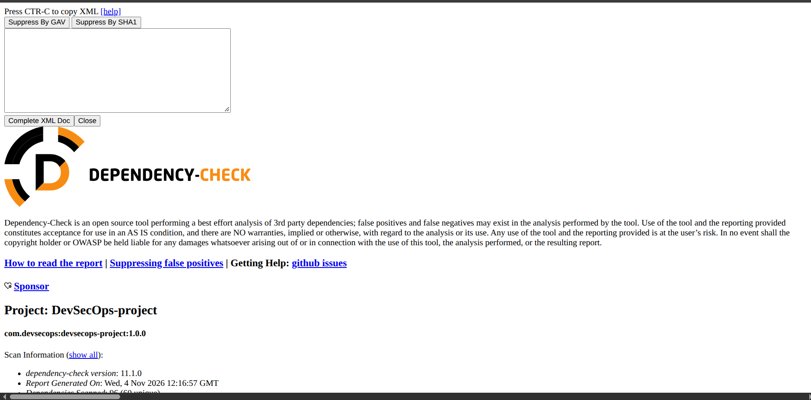
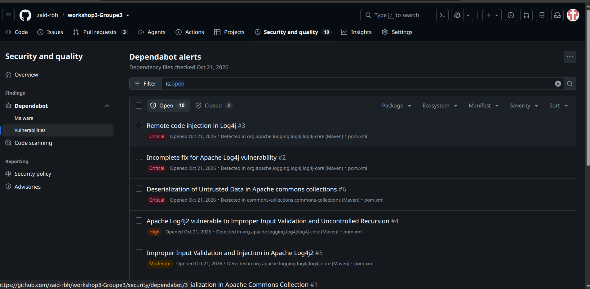
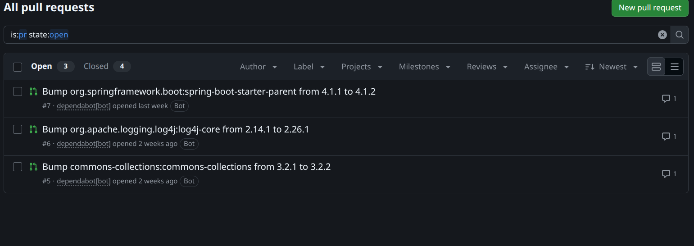
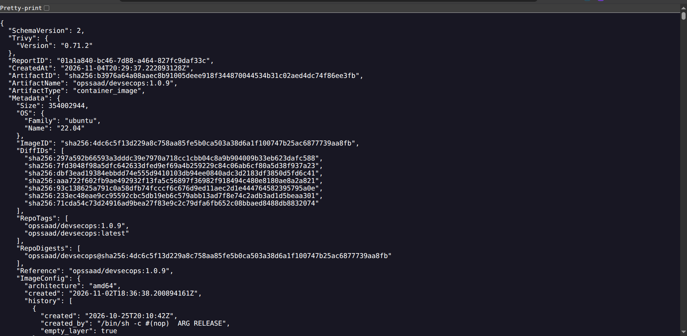

# DevSecOps-project (VulnerableShop)

A small online shop built with Java and Spring Boot, **made insecure on purpose** for a university DevSecOps course.

> ## ⚠️ Intentionally vulnerable. Run it on your own computer only.
> Never deploy it on a server, a shared network or the internet.
> It only listens on `127.0.0.1` and uses fictional data.

**What is it for?** Practising source-code and dependency security review. Examples of security scans
performed during the course are documented below.

---

## Quick start (about 10 minutes)

**You need:** Windows 11, [JDK 21](https://adoptium.net/), [IntelliJ IDEA](https://www.jetbrains.com/idea/download/)
(Community is fine) and an internet connection for the first run.

**1. Check Java.** Open PowerShell:

```powershell
java -version
```

It must say version `21`. If not, install JDK 21, then open a new PowerShell window.

**2. Open the project in IntelliJ.**
`File > Open` → choose the folder that contains `pom.xml` → `Trust Project`.
Wait until the progress bar at the bottom disappears (Maven is downloading libraries).

**3. Set Java 21.**
`File > Project Structure > Project` → set **SDK** to JDK 21 (use `Add SDK > Download JDK` if needed).

**4. Run.**
Open `src/main/java/com/devsecops/project/DevSecOpsProjectApplication.java` and click the green ▶ next to `main`.
When the console shows `Started DevSecOpsProjectApplication`, open **http://localhost:8080**.

Stop: red ■ in the Run window. Restart: green circular arrow.

> Prefer the command line and already have Maven? Run `mvn spring-boot:run` in the project folder.

---

## Demo accounts (all fictional)

| Username | Password | Role |
|---|---|---|
| `admin` | `admin123` | Administrator |
| `alice` | `alice123` | Customer |
| `bob` | `123456` | Customer |
| `charlie` | `qwerty` | Customer |

The admin pages are at http://localhost:8080/admin.

## Reset the database

The database is stored in the `data` folder. Stop the app, delete that folder, start the app again:

```powershell
Remove-Item -Recurse -Force .\data
```

Sample users, products and orders are re-created automatically. To also clear uploaded test files, delete `uploads`.

## Something went wrong?

| Problem | Fix |
|---|---|
| `java -version` is not 21 | Install JDK 21 and select it in `Project Structure` (step 3). |
| `release version 21 not supported` | IntelliJ is using an older JDK. Select JDK 21 (step 3). |
| Red imports or missing libraries | Check your internet, then open the **Maven** panel and click **Reload All Maven Projects**. |
| `Port 8080 was already in use` | Close the other program, or add `server.port=8081` to `application.properties`. |
| `Database may be already in use` | A previous run is still active. Stop it, then start again. |
| Broken data after a crash | Stop the app and reset the database (see above). |
| Error mentioning `requestMatchers` and several servlets | Add `spring.h2.console.enabled=false` to `application.properties`. |
| A page shows a stack trace | Expected for some invalid requests. Detailed errors are one of the intentional weaknesses. |

---

## What can you do in the app?

**Customers:** register and log in, edit your profile, browse and search products, read and write reviews,
use the cart, place a simulated order, see your order history, try the file-upload page.

**Administrators:** dashboard with statistics, list of users, add/edit/delete products, list of all orders.

## Technologies

Java 21 · Spring Boot 3.5 · Spring MVC · Thymeleaf · Spring Data JPA (Hibernate) · H2 database ·
Spring Security (weak on purpose) · Bootstrap 5 (bundled locally) · Maven

## Jenkins pipeline

The `Jenkinsfile` builds and tests the project, runs SonarQube, Semgrep and OWASP Dependency-Check scans,
builds the Docker image, scans it with Trivy, runs an OWASP ZAP baseline scan, then publishes the image. Configure the Jenkins agent with Git, Java 21, the Docker CLI
and access to a Docker daemon; install Semgrep and Trivy on the agent and make the `semgrep` and `trivy` commands available on `PATH`. The ZAP stage runs the `zaproxy/zap-stable` image, so the Docker daemon must be reachable from the agent, and the application must be running on port 8080.

Configure these Jenkins tools and integrations using the exact names referenced by the pipeline:

| Jenkins configuration | Required name or setting |
|---|---|
| Maven installation | `Maven3` |
| SonarQube Scanner installation | `SonarQubeScanner` |
| SonarQube server configuration | `SonarQube`, with its authentication token configured in Jenkins |
| Docker Hub credential | ID `docker-hub-credentials`, type **Username with password** |
| NVD API key | ID `nvd-api-key`, type **Secret text** |

The pipeline also requires the Pipeline, Git, JUnit, Workspace Cleanup, SonarQube Scanner for Jenkins,
Credentials Binding and HTML Publisher plugins. Configure the SonarQube webhook to point to the Jenkins
`/sonarqube-webhook/` endpoint. The JUnit report archiving is optional when no tests produce reports.

---

# Rapport – WorkShop 2 : Analyse SAST avec SonarQube et Semgrep

**Groupe :** Groupe 3 · **Branche :** `saad-workshop2` · **Projet :** DevSecOps-VulnerableShop (Spring Boot, Java 21)

## 1. Objectif

Mettre en place une chaîne CI/CD sous **Jenkins** qui compile le projet, puis l'analyse avec deux outils
de **SAST** (analyse statique du code source) :

- **SonarQube** : qualité du code et vulnérabilités (sécurité, fiabilité, maintenabilité) ;
- **Semgrep** : détection de motifs dangereux par règles (`p/ci`), rapport JSON archivé.

L'image Docker de l'application est ensuite construite et publiée sur Docker Hub.

## 2. Pipeline Jenkins

Le pipeline est défini dans le fichier [`Jenkinsfile`](Jenkinsfile) à la racine du dépôt.

| # | Étape | Description |
|---|---|---|
| 1 | Checkout Code | Récupération du code depuis GitHub (`checkout scm`). |
| 2 | Build & Test | `mvn -B clean package` avec l'outil Maven `Maven3` ; publication des rapports JUnit. |
| 3 | Security Scans | Semgrep et OWASP Dependency-Check s'exécutent en parallèle ; leurs rapports sont archivés lorsqu'ils existent. |
| 4 | SonarQube Analysis | `sonar-scanner` sur `src/main/java` (clé de projet `devsecops`). |
| 5 | Quality Gate Check | Attente du résultat SonarQube avant les étapes Docker. |
| 6 | Build Docker Image | Construction de `opssaad/devsecops:1.0.<BUILD_NUMBER>` et `latest` via le [`Dockerfile`](Dockerfile). |
| 7 | Push to Docker Hub | Connexion avec l'identifiant Jenkins `docker-hub-credentials`, puis `docker push` hors pull requests. |
| 8 | Publish Security Reports | Publication du rapport HTML OWASP s'il est disponible. |

Le `Dockerfile` utilise un build en deux étapes : compilation avec Maven (Temurin 21), puis image d'exécution
JRE 21 allégée exposant le port 8080.

## 3. Résultats SonarQube


| Indicateur | Résultat |
|---|---|
| Quality Gate | **Passed** |
| Taille analysée | 1,3 k lignes de code (Java) |
| Sécurité | **7** problèmes – note **E** |
| Fiabilité | **1** problème – note **D** |
| Maintenabilité | **0** problème – note **A** |
| Hotspots revus | — (note **A**) |
| Couverture de tests | 0,0 % |
**Analyse :** le Quality Gate est « Passed » (la porte par défaut ne porte que sur le *nouveau* code), mais
la note de sécurité **E** montre clairement les failles volontairement présentes dans l'application. La
couverture est à 0 % car le projet ne contient pas de tests automatisés.

## 4. Résultats Semgrep


Semgrep a analysé **64 fichiers suivis par git** avec **160 règles** de la communauté (`p/ci`) :

| Langage | Règles | Fichiers |
|---|---|---|
| Multilangage | 2 | 64 |
| Java | 32 | 35 |
| HTML | 1 | 18 |
| JavaScript | 16 | 1 |
| YAML | 12 | 1 |
| Dockerfile | 2 | 1 |

Le détail des résultats est dans l'artefact `semgrep-report.json` de chaque build Jenkins.

## 5. Résultats OWASP Dependency-Check



OWASP Dependency-Check analyse les dépendances tierces afin d'identifier les vulnérabilités connues.
La capture montre le rapport HTML du projet, généré avec la version **11.1.0** de l'outil le 4 novembre 2026.
Elle ne montre pas le détail des vulnérabilités détectées ; consultez le rapport complet pour les examiner.

Dans Jenkins, le scan utilise la clé NVD associée au credential `nvd-api-key` et archive le rapport
`reports/owasp/dependency-check-report.html` lorsqu'il existe. L'étape de publication HTML intervient après
les étapes Docker. Dans la configuration actuelle, les erreurs du scan OWASP sont ignorées et ne bloquent
donc pas le pipeline.

## 6. Résultats Dependabot

Dependabot surveille les dépendances Maven et les images Docker chaque semaine, selon la configuration
dans [`.github/dependabot.yml`](.github/dependabot.yml).



Lors de la capture, GitHub affichait **10 alertes ouvertes**, notamment pour Log4j et Apache Commons
Collections.



La capture montre **3 pull requests ouvertes** proposant des mises à jour de Spring Boot, Log4j et
Commons Collections. Ces résultats reflètent l'état du dépôt au moment des captures ; les propositions
doivent être vérifiées et testées avant leur fusion.

## 7. Conclusion

- Le projet **compile sans erreur** (étape *Build & Test* réussie).
- Le pipeline automatise la compilation, deux analyses SAST complémentaires, un contrôle des dépendances
  et la publication de l'image.
- SonarQube a signalé 7 problèmes de sécurité et 1 de fiabilité ; Semgrep a parcouru tous les fichiers
  Java, HTML, JavaScript et le Dockerfile.

**Pistes d'amélioration :** rendre le contrôle OWASP bloquant en cas d'erreur ou de vulnérabilité critique,
ajouter des tests unitaires pour mesurer la couverture, puis corriger les failles détectées.

# Rapport – WorkShop 5 : Scan d'image avec Trivy et DAST avec OWASP ZAP

**Groupe :** Groupe 3 · **Branche :** `saad-workshop5` · **Projet :** DevSecOps-VulnerableShop (Spring Boot, Java 21)

## 1. Objectif

Compléter la chaîne CI/CD du WorkShop 2 avec deux contrôles de sécurité supplémentaires :

- **Trivy** : analyse de l'**image Docker** construite (paquets du système et bibliothèques Java embarquées) ;
- **OWASP ZAP** : analyse **dynamique (DAST)** de l'application en cours d'exécution, vue de l'extérieur comme le ferait un attaquant.

Les deux outils complètent les analyses statiques (SonarQube, Semgrep) et de dépendances (OWASP Dependency-Check) déjà en place.

## 2. Pipeline Jenkins mis à jour

| # | Étape | Description |
|---|---|---|
| 1 | Checkout Code | Récupération du code (`checkout scm`). |
| 2 | Build & Test | `mvn -B clean package` ; publication des rapports JUnit. |
| 3 | Security Scans | Semgrep et OWASP Dependency-Check en parallèle. |
| 4 | SonarQube Analysis | `sonar-scanner` sur `src/main/java`. |
| 5 | Quality Gate Check | Attente du résultat SonarQube (le pipeline échoue si la porte n'est pas `OK`). |
| 6 | Build Docker Image | Construction de `opssaad/devsecops:1.0.<BUILD_NUMBER>` et `latest`. |
| 7 | **Trivy Container Scan** | Analyse de l'image construite, rapport `trivy-report.json`. |
| 8 | **OWASP ZAP Baseline Scan** | Scan DAST de l'application, rapport `zap-report.html`. |
| 9 | Push to Docker Hub | Publication de l'image, hors pull requests. |
| 10 | Publish Security Reports | Publication du rapport HTML OWASP Dependency-Check. |

## 3. Trivy – analyse de l'image Docker

**Principe :** Trivy compare le contenu de l'image (paquets de la couche JRE `eclipse-temurin:21-jre-jammy` et bibliothèques Java du `app.jar`) avec les bases de vulnérabilités connues (CVE).

**Configuration dans le `Jenkinsfile` :**

```groovy
stage('Trivy Container Scan') {
    steps {
        sh "trivy image --format json -o trivy-report.json --severity HIGH,CRITICAL ${IMAGE_NAME}:${IMAGE_TAG} || true"
    }
    post {
        always { archiveArtifacts artifacts: 'trivy-report.json', allowEmptyArchive: true }
    }
}
```

| Paramètre | Valeur | Explication |
|---|---|---|
| Cible | `opssaad/devsecops:1.0.<BUILD_NUMBER>` | L'image qui vient d'être construite. |
| Format | `json` | Même format que Semgrep, facile à archiver et à exploiter. |
| Sévérités | `HIGH`, `CRITICAL` | Seules les vulnérabilités importantes sont rapportées. |
| `|| true` | activé | Le scan **ne bloque pas** le pipeline, même si des vulnérabilités sont trouvées. |
| Artefact | `trivy-report.json` | Archivé à chaque build, même en cas d'échec (`always`). |



**Résultats :** *(à compléter avec les chiffres du dernier build : nombre de vulnérabilités `HIGH` / `CRITICAL`, paquets les plus touchés, versions corrigées proposées.)*

## 4. OWASP ZAP – scan dynamique (DAST)

**Principe :** ZAP en mode *baseline* explore l'application en cours d'exécution et effectue une analyse **passive** : il observe les requêtes et réponses HTTP et signale des faiblesses (en-têtes de sécurité manquants, cookies sans attributs `Secure`/`HttpOnly`, fuites d'informations, etc.). Il n'envoie pas d'attaques actives.

**Configuration dans le `Jenkinsfile` :**

```groovy
docker run --user root --rm -v "$(pwd)/reports/zap:/zap/wrk:rw" -t zaproxy/zap-stable \
    zap-baseline.py -t http://host.docker.internal:8080/login -r zap-report.html || true
```

| Paramètre | Valeur | Explication |
|---|---|---|
| Image | `zaproxy/zap-stable` | Image officielle de ZAP, exécutée dans un conteneur jetable (`--rm`). |
| Script | `zap-baseline.py` | Scan rapide et passif, adapté à un pipeline CI. |
| Cible | `http://host.docker.internal:8080/login` | Page de connexion de l'application, accessible depuis le conteneur ZAP. |
| Volume | `reports/zap` → `/zap/wrk` | Permet de récupérer le rapport HTML sur l'agent Jenkins. |
| `--user root` | activé | Évite les erreurs de droits d'écriture sur le dossier monté. |
| `|| true` | activé | Le scan **ne bloque pas** le pipeline (ZAP retourne un code non nul s'il trouve des alertes). |
| Artefact | `reports/zap/zap-report.html` | Archivé à chaque build. |

> **Prérequis :** ZAP scanne une application **déjà démarrée** sur le port 8080 de l'agent. L'application doit donc tourner (par exemple via `docker run -p 8080:8080 opssaad/devsecops:latest`) pendant l'exécution de l'étape, sinon le rapport sera vide ou en erreur.


**Résultats :** *(à compléter avec les alertes du rapport : nombre d'alertes par niveau `High` / `Medium` / `Low` / `Informational`, et les principales, par exemple en-têtes manquants ou cookies non sécurisés.)*

## 5. Comparaison des outils de sécurité du pipeline

| Outil | Type | Ce qu'il analyse | Moment |
|---|---|---|---|
| SonarQube | SAST | Code source Java | Avant la construction de l'image |
| Semgrep | SAST | Motifs dangereux dans le code | Avant la construction de l'image |
| OWASP Dependency-Check | SCA | Dépendances Maven | Avant la construction de l'image |
| **Trivy** | Scan d'image | Système et bibliothèques de l'image Docker | Après la construction de l'image |
| **OWASP ZAP** | DAST | Application en cours d'exécution | Application démarrée |

## 6. Limites et pistes d'amélioration

- **Les scans Trivy et ZAP ne sont pas bloquants** (`|| true`) : le pipeline publie l'image même si des vulnérabilités `CRITICAL` existent. Pour appliquer une vraie politique de sécurité, utiliser `trivy image --exit-code 1 --severity CRITICAL` et placer l'étape avant `Push to Docker Hub` avec un blocage effectif.
- **Démarrage de l'application pour ZAP :** automatiser le lancement du conteneur avant le scan (et son arrêt ensuite) pour que le DAST fonctionne sur chaque build.
- **Rapport Trivy lisible :** ajouter un rapport HTML ou table en plus du JSON.
- **OWASP Dependency-Check :** retirer les options Maven qui désactivent la vérification SSL (`wagon.http.ssl.insecure`, `allowall`), qui affaiblissent la fiabilité du scan.

## 7. Conclusion

- Le pipeline couvre désormais **tout le cycle** : code source (SAST), dépendances (SCA), image Docker (Trivy) et application en fonctionnement (DAST).
- Trivy et ZAP produisent des rapports archivés à chaque build, consultables dans Jenkins.
- La prochaine étape est de rendre ces contrôles **bloquants** et de corriger les failles détectées.

---

## Project layout

```text
DevSecOps-project/
├── pom.xml                       Maven configuration
├── docs/
│   └── INSTRUCTOR_NOTES.md       List of the weaknesses
└── src/main/
    ├── java/com/devsecops/project/
    │   ├── config/               Security, web settings, sample data
    │   ├── controller/           Web pages and API endpoints
    │   ├── service/              Business logic
    │   ├── repository/           Database access
    │   ├── model/                Database entities
    │   ├── dto/                  Form objects
    │   └── exception/            Error handling
    └── resources/
        ├── application.properties
        ├── static/               CSS and JavaScript
        └── templates/            Thymeleaf pages
```