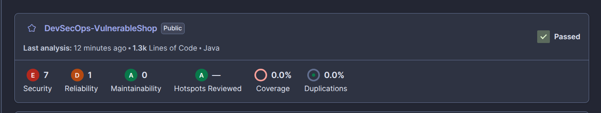
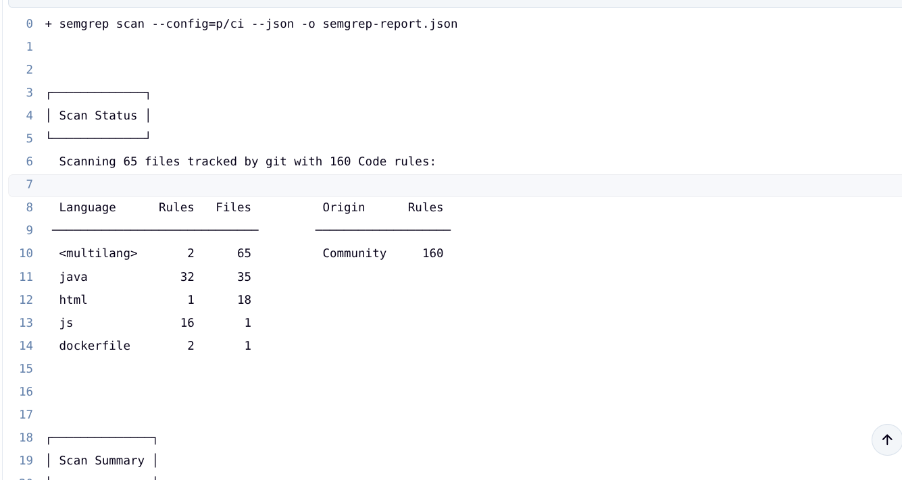

# DevSecOps-project (VulnerableShop)

A small online shop built with Java and Spring Boot, **made insecure on purpose** for a university DevSecOps course.

> ## ⚠️ Intentionally vulnerable. Run it on your own computer only.
> Never deploy it on a server, a shared network or the internet.
> It only listens on `127.0.0.1` and uses fictional data.

**What is it for?** Practising source-code security review. Security analysis tools will be chosen and used
separately during the course. This project has **not** been scanned or audited by any tool.

---

## Quick start (about 10 minutes)

**You need:** Windows 11, [JDK 21](https://adoptium.net/), [IntelliJ IDEA](https://www.jetbrains.com/idea/download/)
(Community is fine) and an internet connection for the first run.

**1. Check Java.** Open PowerShell:

```powershell
java -version
```

It must say version `21`. If not, install JDK 21, then open a new PowerShell window.

**2. Open the project in IntelliJ.**
`File > Open` → choose the folder that contains `pom.xml` → `Trust Project`.
Wait until the progress bar at the bottom disappears (Maven is downloading libraries).

**3. Set Java 21.**
`File > Project Structure > Project` → set **SDK** to JDK 21 (use `Add SDK > Download JDK` if needed).

**4. Run.**
Open `src/main/java/com/devsecops/project/DevSecOpsProjectApplication.java` and click the green ▶ next to `main`.
When the console shows `Started DevSecOpsProjectApplication`, open **http://localhost:8080**.

Stop: red ■ in the Run window. Restart: green circular arrow.

> Prefer the command line and already have Maven? Run `mvn spring-boot:run` in the project folder.

---

## Demo accounts (all fictional)

| Username | Password | Role |
|---|---|---|
| `admin` | `admin123` | Administrator |
| `alice` | `alice123` | Customer |
| `bob` | `123456` | Customer |
| `charlie` | `qwerty` | Customer |

The admin pages are at http://localhost:8080/admin.

## Reset the database

The database is stored in the `data` folder. Stop the app, delete that folder, start the app again:

```powershell
Remove-Item -Recurse -Force .\data
```

Sample users, products and orders are re-created automatically. To also clear uploaded test files, delete `uploads`.

## Something went wrong?

| Problem | Fix |
|---|---|
| `java -version` is not 21 | Install JDK 21 and select it in `Project Structure` (step 3). |
| `release version 21 not supported` | IntelliJ is using an older JDK. Select JDK 21 (step 3). |
| Red imports or missing libraries | Check your internet, then open the **Maven** panel and click **Reload All Maven Projects**. |
| `Port 8080 was already in use` | Close the other program, or add `server.port=8081` to `application.properties`. |
| `Database may be already in use` | A previous run is still active. Stop it, then start again. |
| Broken data after a crash | Stop the app and reset the database (see above). |
| Error mentioning `requestMatchers` and several servlets | Add `spring.h2.console.enabled=false` to `application.properties`. |
| A page shows a stack trace | Expected for some invalid requests. Detailed errors are one of the intentional weaknesses. |

---

## What can you do in the app?

**Customers:** register and log in, edit your profile, browse and search products, read and write reviews,
use the cart, place a simulated order, see your order history, try the file-upload page.

**Administrators:** dashboard with statistics, list of users, add/edit/delete products, list of all orders.

## Technologies

Java 21 · Spring Boot 3.5 · Spring MVC · Thymeleaf · Spring Data JPA (Hibernate) · H2 database ·
Spring Security (weak on purpose) · Bootstrap 5 (bundled locally) · Maven

## Jenkins pipeline

The `Jenkinsfile` builds and tests the project, runs SonarQube and Semgrep scans, then builds and publishes
the Docker image. Configure the Jenkins agent with Git, Java 21, the Docker CLI and access to a Docker daemon;
install Semgrep on the agent and make the `semgrep` command available on `PATH`.

Configure these Jenkins tools and integrations using the exact names referenced by the pipeline:

| Jenkins configuration | Required name or setting |
|---|---|
| Maven installation | `Maven3` |
| SonarQube Scanner installation | `SonarQubeScanner` |
| SonarQube server configuration | `SonarQube`, with its authentication token configured in Jenkins |
| Docker Hub credential | ID `docker-hub-credentials`, type **Username with password** |

The pipeline also requires the Pipeline, Git, JUnit, Workspace Cleanup, SonarQube Scanner for Jenkins and
Credentials Binding plugins. The JUnit report archiving is optional when no tests produce reports.

---

# Rapport – WorkShop 2 : Analyse SAST avec SonarQube et Semgrep

**Groupe :** Groupe 3 · **Branche :** `saad-workshop2` · **Projet :** DevSecOps-VulnerableShop (Spring Boot, Java 21)

## 1. Objectif

Mettre en place une chaîne CI/CD sous **Jenkins** qui compile le projet, puis l'analyse avec deux outils
de **SAST** (analyse statique du code source) :

- **SonarQube** : qualité du code et vulnérabilités (sécurité, fiabilité, maintenabilité) ;
- **Semgrep** : détection de motifs dangereux par règles (`p/ci`), rapport JSON archivé.

L'image Docker de l'application est ensuite construite et publiée sur Docker Hub.

## 2. Pipeline Jenkins

Le pipeline est défini dans le fichier [`Jenkinsfile`](Jenkinsfile) à la racine du dépôt.

| # | Étape | Description |
|---|---|---|
| 1 | Checkout Code | Récupération du code depuis GitHub (`checkout scm`). |
| 2 | Build & Test | `mvn -B clean package` avec l'outil Maven `Maven3` ; publication des rapports JUnit. |
| 3 | SonarQube Analysis | `sonar-scanner` sur `src/main/java` (clé de projet `devsecops`). |
| 4 | Semgrep SAST Scan | `semgrep scan --config=p/ci --json -o semgrep-report.json` ; le rapport est archivé comme artefact. |
| 5 | Build Docker Image | Construction de `opssaad/devsecops:1.0.<BUILD_NUMBER>` et `latest` via le [`Dockerfile`](Dockerfile). |
| 6 | Push to Docker Hub | Connexion avec l'identifiant Jenkins `docker-hub-credentials`, puis `docker push`. |

Le `Dockerfile` utilise un build en deux étapes : compilation avec Maven (Temurin 21), puis image d'exécution
JRE 21 allégée exposant le port 8080.

## 3. Résultats SonarQube



| Indicateur | Résultat |
|---|---|
| Quality Gate | **Passed** |
| Taille analysée | 1,3 k lignes de code (Java) |
| Sécurité | **7** problèmes – note **E** |
| Fiabilité | **1** problème – note **D** |
| Maintenabilité | **0** problème – note **A** |
| Hotspots revus | — (note **A**) |
| Couverture de tests | 0,0 % |
**Analyse :** le Quality Gate est « Passed » (la porte par défaut ne porte que sur le *nouveau* code), mais
la note de sécurité **E** montre clairement les failles volontairement présentes dans l'application. La
couverture est à 0 % car le projet ne contient pas de tests automatisés.

## 4. Résultats Semgrep



Semgrep a analysé **65 fichiers suivis par git** avec **160 règles** de la communauté (`p/ci`) :

| Langage | Règles | Fichiers |
|---|---|---|
| Multilangage | 2 | 65 |
| Java | 32 | 35 |
| HTML | 1 | 18 |
| JavaScript | 16 | 1 |
| Dockerfile | 2 | 1 |

Le détail des résultats est dans l'artefact `semgrep-report.json` de chaque build Jenkins.

## 5. Conclusion

- Le projet **compile sans erreur** (étape *Build & Test* réussie).
- Le pipeline automatise la compilation, deux analyses SAST complémentaires et la publication de l'image.
- SonarQube a signalé 7 problèmes de sécurité et 1 de fiabilité ; Semgrep a parcouru tous les fichiers
  Java, HTML, JavaScript et le Dockerfile.

**Pistes d'amélioration :** ajouter un contrôle bloquant (`waitForQualityGate`), retirer le `|| true` de
l'étape Semgrep pour faire échouer le build sur les résultats critiques, ajouter des tests unitaires pour
mesurer la couverture, puis corriger les failles détectées.

## Project layout

```text
DevSecOps-project/
├── pom.xml                       Maven configuration
├── docs/
│   └── INSTRUCTOR_NOTES.md       List of the weaknesses
└── src/main/
    ├── java/com/devsecops/project/
    │   ├── config/               Security, web settings, sample data
    │   ├── controller/           Web pages and API endpoints
    │   ├── service/              Business logic
    │   ├── repository/           Database access
    │   ├── model/                Database entities
    │   ├── dto/                  Form objects
    │   └── exception/            Error handling
    └── resources/
        ├── application.properties
        ├── static/               CSS and JavaScript
        └── templates/            Thymeleaf pages
```