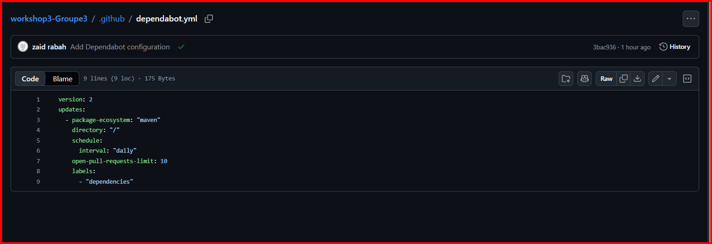
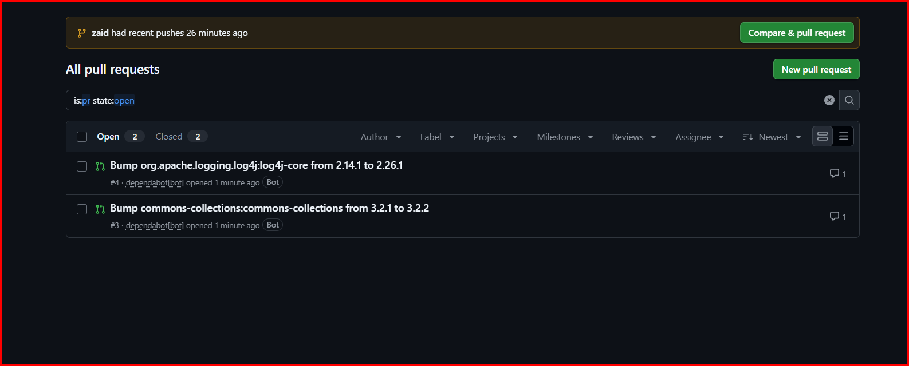
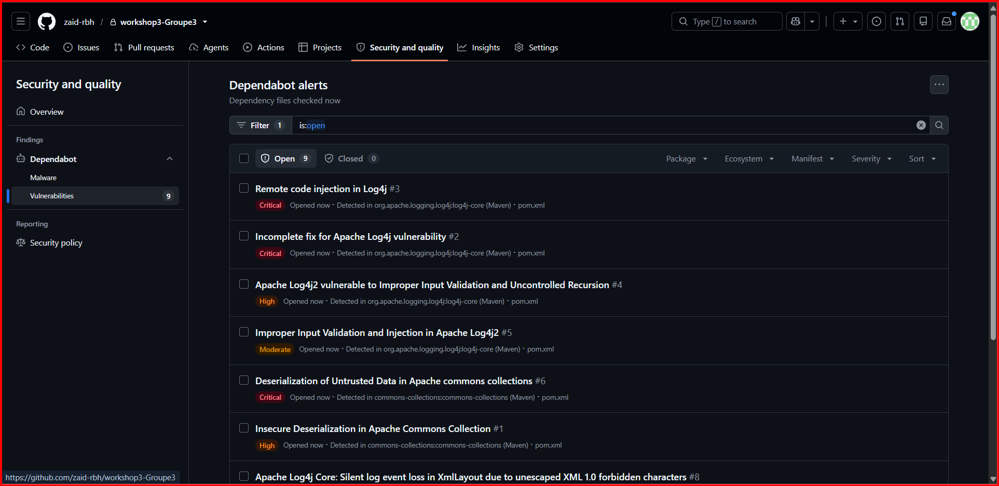
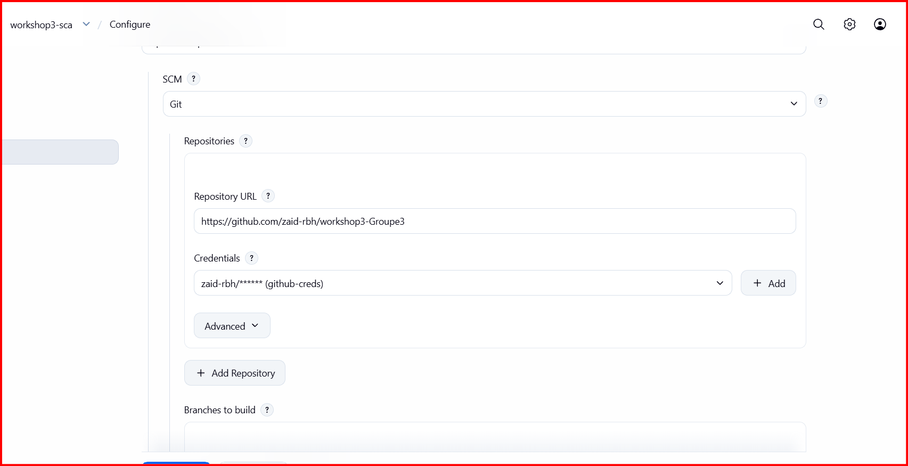

# Workshop 3 : Sécurité des dépendances (SCA)

**Dependabot & OWASP Dependency-Check** sur un projet Maven (VulnerableShop, Java 21 / Spring Boot).

- **Cours :** DevSecOps, chapitre 3 « Sécurité des dépendances et librairies (SCA) »
- **Dépôt :** `workshop3-Groupe3`

## Statut du rendu

| Partie | État |
|---|---|
| Configuration de Dependabot | Terminée |
| Pull requests de mise à jour (Dependabot) | Terminées (2 PR) |
| Alertes de sécurité Dependabot | Terminées (9 alertes détectées) |
| Pipeline Jenkins avec le stage OWASP Dependency-Check | Configuré et versionné dans le `Jenkinsfile` |
| Rapport OWASP Dependency-Check | **En cours au moment du rendu** : le premier téléchargement de la base NVD (environ 413 000 enregistrements) n'était pas terminé |

Le rapport OWASP sera ajouté au dépôt dans un commit ultérieur, dès la fin du scan. Aucun résultat n'est inventé dans ce README : les sections qui en dépendent sont clairement indiquées comme en attente.

---

## 1. Installation rapide

### Prérequis

- Java 21 et Maven 3.9+
- Docker avec un conteneur Jenkins (plugins Pipeline et Git, outil Maven nommé `Maven3`)
- Un compte GitHub avec Dependabot activé sur le dépôt
- Une clé d'API NVD (gratuite), stockée dans Jenkins comme credential *Secret text* d'ID `nvd-api-key`

### Compilation

```bash
mvn -B clean verify
```

### Lancer l'analyse OWASP Dependency-Check

1. Créer un job Pipeline `workshop3-sca` dans Jenkins : *Pipeline script from SCM*, branche `*/<ma-branche>`, script path `Jenkinsfile`.
2. Cliquer sur **Build Now**.
3. Récupérer le rapport dans les artefacts du build : `target/dependency-check-report.html`.

> La première exécution télécharge toute la base NVD et peut durer plus d'une heure, car l'API NVD limite le débit des requêtes. Les exécutions suivantes sont beaucoup plus rapides, car la base est conservée dans un volume Jenkins.

---

## 2. Introduction

### Objectif

Sécuriser les dépendances d'un projet Maven avec deux outils complémentaires :

- **Dependabot** (GitHub) : propose automatiquement des mises à jour et signale les dépendances vulnérables.
- **OWASP Dependency-Check** (Jenkins) : analyse les dépendances à chaque build et produit un rapport de CVE.

### Organisation du groupe

Le groupe travaille sur le même projet. Chaque membre dispose de sa propre branche et de son propre pipeline Jenkins. La configuration Dependabot et les alertes se trouvent sur `main`, car GitHub n'analyse que la branche par défaut. Le README est commun.

| Membre | Branche | Pipeline |
|---|---|---|
| Zaid | `zaid` | `Jenkinsfile` de la branche `zaid` |
| À COMPLÉTER | À COMPLÉTER | À COMPLÉTER |
| À COMPLÉTER | À COMPLÉTER | À COMPLÉTER |

### Projet analysé

VulnerableShop est une application Spring Boot (Java 21, Maven). Pour les besoins du workshop, deux dépendances **volontairement obsolètes** ont été ajoutées au `pom.xml` :

| Dépendance | Version | Raison |
|---|---|---|
| `org.apache.logging.log4j:log4j-core` | 2.14.1 | Version affectée par Log4Shell et d'autres CVE |
| `commons-collections:commons-collections` | 3.2.1 | Version affectée par des failles de désérialisation |

---

## 3. Réalisation

### 3.1 Dependabot

#### Configuration

Le fichier `.github/dependabot.yml` active la surveillance de l'écosystème Maven :

```yaml
version: 2
updates:
  - package-ecosystem: "maven"
    directory: "/"
    schedule:
      interval: "daily"
    open-pull-requests-limit: 10
    labels:
      - "dependencies"
```

Dans **Settings → Code security**, le graphe de dépendances, les alertes Dependabot et les mises à jour de sécurité sont activés.



#### Mises à jour de version (pull requests)

Dependabot a analysé le `pom.xml` de `main` et ouvert deux pull requests, toutes deux fusionnées dans `main` :

| PR | Mise à jour | Type |
|---|---|---|
| #1 | `org.webjars:bootstrap` 5.3.3 → 5.3.8 | Patch |
| #2 | `spring-boot-starter-parent` 3.5.6 → 4.1.1 | **Majeure** |

La PR #2 est un changement de version majeure de Spring Boot. Une telle mise à jour peut demander une migration du code : elle ne doit pas être fusionnée sans vérifier que le projet compile.



#### Alertes de sécurité

Après l'ajout des dépendances obsolètes sur `main`, Dependabot a généré **9 alertes** sur 2 bibliothèques :

| Bibliothèque | Version | Alertes | Sévérités |
|---|---|---|---|
| `log4j-core` | 2.14.1 | #2, #3, #4, #5, #7, #8, #9 | 2 critical, 1 high, 4 moderate |
| `commons-collections` | 3.2.1 | #1, #6 | 1 critical, 1 high |

| # | Sévérité | Bibliothèque | Problème |
|---|---|---|---|
| 3 | Critical | log4j-core | Injection de code à distance dans Log4j |
| 2 | Critical | log4j-core | Correctif incomplet pour une vulnérabilité Log4j |
| 4 | High | log4j-core | Validation d'entrée incorrecte et récursion non contrôlée |
| 5 | Moderate | log4j-core | Validation d'entrée incorrecte et injection |
| 7 | Moderate | log4j-core | Le nom d'hôte TLS n'est pas vérifié (Socket Appender) |
| 8 | Moderate | log4j-core | Perte silencieuse d'événements (XmlLayout, caractères XML interdits) |
| 9 | Moderate | log4j-core | Attribut `verifyHostName` ignoré dans la configuration TLS |
| 6 | Critical | commons-collections | Désérialisation de données non fiables |
| 1 | High | commons-collections | Désérialisation non sécurisée |



### 3.2 OWASP Dependency-Check dans Jenkins

#### Configuration du pipeline

Le stage suivant est ajouté au `Jenkinsfile` après la compilation :

```groovy
stage('OWASP Dependency-Check') {
    steps {
        withCredentials([string(credentialsId: 'nvd-api-key', variable: 'NVD_API_KEY')]) {
            sh '''
                mvn -B org.owasp:dependency-check-maven:check \
                  -DnvdApiKey=$NVD_API_KEY \
                  -DdataDirectory=/var/jenkins_home/dependency-check-data \
                  -Dformats=HTML,JSON \
                  -DfailBuildOnCVSS=11 \
                  -DossindexAnalyzerEnabled=false
            '''
        }
    }
}
```

| Option | Rôle |
|---|---|
| `nvdApiKey` | Clé NVD lue depuis le credential Jenkins, jamais écrite dans le code |
| `dataDirectory` | Conserve la base NVD dans le volume Jenkins pour éviter de la retélécharger |
| `formats=HTML,JSON` | Génère un rapport lisible et un rapport exploitable par un outil |
| `failBuildOnCVSS=11` | Ne bloque pas le build (le score maximum est 10), utilisé pour le premier scan |
| `ossindexAnalyzerEnabled=false` | Désactive l'analyseur OSS Index, qui demande un compte |

Les rapports sont archivés dans la section `post { always { ... } }` du pipeline.



#### État du scan au moment du rendu

Lors du premier build, Dependency-Check télécharge la base NVD complète. Au moment du rendu, le téléchargement était en cours : environ 413 000 enregistrements au total, avec des relances automatiques de requêtes dues à la limitation de débit de l'API NVD.

```
[INFO] NVD API has 412,813 records in this update
[INFO] Downloaded 10,000/412,813 (2%)
[WARNING] Retrying request /rest/json/cves/2.0?... : 2nd time
[INFO] Downloaded 20,000/412,851 (5%)
```

Le rapport (`dependency-check-report.html`) n'a donc pas encore été généré. Il sera ajouté au dépôt, avec ses captures d'écran, dans un commit ultérieur.

#### Résultats attendus

Le rapport devrait signaler les deux dépendances volontairement obsolètes, avec les mêmes familles de vulnérabilités que celles trouvées par Dependabot (exécution de code à distance dans Log4j, désérialisation non sécurisée dans commons-collections). Cette attente est à vérifier avec le rapport final et ne constitue pas un résultat.

### 3.3 Comparaison des deux outils

| Critère | Dependabot | OWASP Dependency-Check |
|---|---|---|
| Où il s'exécute | GitHub, en continu | Dans le pipeline CI, à chaque build |
| Source de données | GitHub Advisory Database | NVD |
| Résultat | Alertes et pull requests automatiques | Rapport HTML/JSON, peut faire échouer le build |
| Points forts | Propose le correctif lui-même | Seuil configurable, intégré au pipeline |
| Limites | Réservé à GitHub, analyse la branche par défaut | Premier scan très long, faux positifs possibles |

### 3.4 Corrections

Les alertes Dependabot indiquent, pour chaque vulnérabilité, la version corrigée. La correction consiste à mettre à jour les deux dépendances dans le `pom.xml` vers ces versions, puis à vérifier la compilation avec `mvn -B clean verify` avant le commit.

| Dépendance | Version vulnérable | Correction |
|---|---|---|
| `log4j-core` | 2.14.1 | Mise à jour vers la version corrigée indiquée par les alertes |
| `commons-collections` | 3.2.1 | Mise à jour vers la version corrigée indiquée par les alertes |

Après la correction, les alertes Dependabot passent à l'état « Closed », et le scan OWASP final permettra de comparer les résultats avant et après.

### 3.5 Seuil de blocage du pipeline

Une fois les vulnérabilités corrigées, le seuil est abaissé de `-DfailBuildOnCVSS=11` à `-DfailBuildOnCVSS=7`. Le pipeline échoue alors dès qu'une CVE de score CVSS supérieur ou égal à 7 (High ou Critical) est détectée.

---

## 4. Conclusion

Les deux outils répondent à des besoins différents et se complètent. Dependabot surveille le dépôt en continu et propose directement la mise à jour sous forme de pull request, tandis qu'OWASP Dependency-Check s'intègre au pipeline et peut bloquer un build selon un seuil de gravité.

Ce workshop montre aussi trois limites :

- une mise à jour automatique n'est pas toujours sûre : la PR #2 propose un saut de version majeure de Spring Boot, qui demande une vérification et souvent une migration ;
- le premier scan Dependency-Check est très long, car il télécharge toute la base NVD, et l'API limite le débit même avec une clé ;
- Dependabot ne signale que ce que GitHub sait résoudre dans le `pom.xml` de la branche par défaut.

Le rapport OWASP et la comparaison chiffrée avant/après seront ajoutés dès la fin du scan.

---

## Annexe : captures d'écran

**Fournies :**

| Fichier | Contenu |
|---|---|
| `01-dependabot-config.png` | Fichier `dependabot.yml` sur GitHub |
| `02-dependabot-prs.png` | Pull requests ouvertes par Dependabot |
| `03-dependabot-alerts.png` | Liste des 9 alertes |
| `04-jenkins-job-config.png` | Configuration du job Jenkins |

**À venir avec le rapport OWASP :** résumé du rapport, détail d'une CVE, alertes fermées après correction, build en échec puis réussi avec le seuil CVSS 7.
